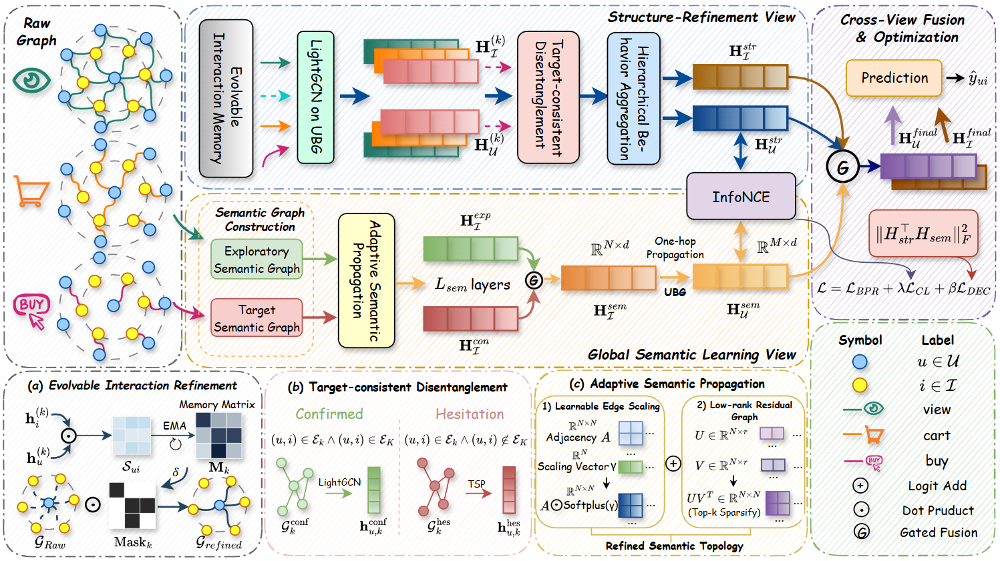

# GSSR

Official code for **GSSR** (Global Semantic Learning and Structural Refinement for Multi-Behavior Recommendation).



## Prerequisites

```bash
conda create -n GSSR python=3.9
conda activate GSSR
pip install -r requirements.txt
```

## Datasets

| Dataset | Users | Items | Behaviors |
|---------|-------|-------|-----------|
| Taobao | 48,749 | 39,493 | view, cart, buy |
| Tmall | 41,738 | 11,953 | view, cart, collect, buy |
| IJCAI | 15,692 | 10,160 | view, cart, collect, buy |

Sources: [CRGCN](https://github.com/MingshiYan/CRGCN), [MULE](https://github.com/geonwooko/MULE), [DeMBR](https://github.com/DeMBR2024/DeMBR).

## Usage

### Build item graphs

```bash
python ./src/build_item_graph.py --dataset taobao
```

### Train

```bash
# Taobao
python ./src/main.py --dataset taobao \
  --lr 1e-4 --weight_decay 0 \
  --tsp_layers 5 --emb_dim 64 \
  --num_epochs 130 --batch_size 1024

# Tmall
python ./src/main.py --dataset tmall \
  --lr 1e-4 --weight_decay 1e-5 \
  --tsp_layers 6 --emb_dim 64 \
  --num_epochs 100 --batch_size 1024

# IJCAI
python ./src/main.py --dataset IJCAI \
  --lr 1e-4 --weight_decay 0 \
  --tsp_layers 5 --sem_layers 2 --emb_dim 64 \
  --num_epochs 130 --batch_size 1024
```
